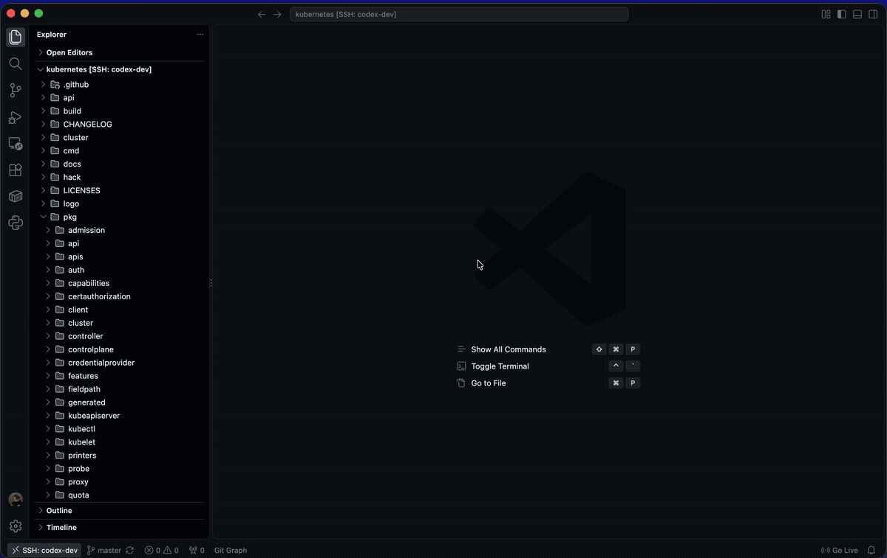
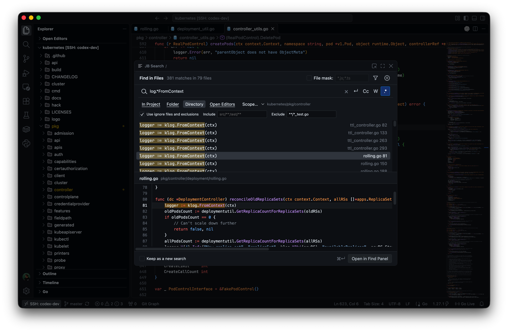
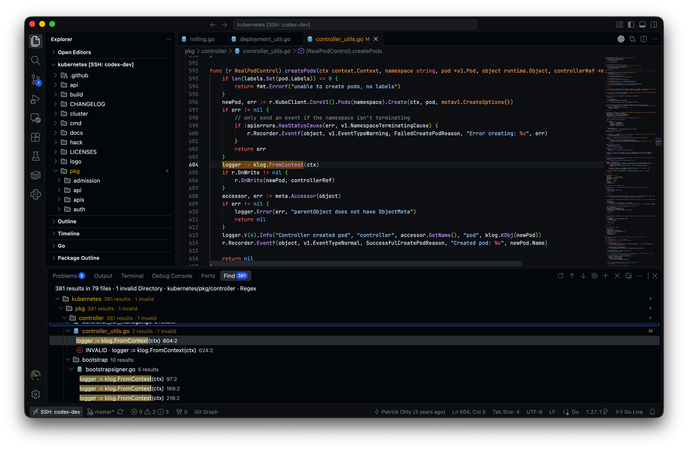
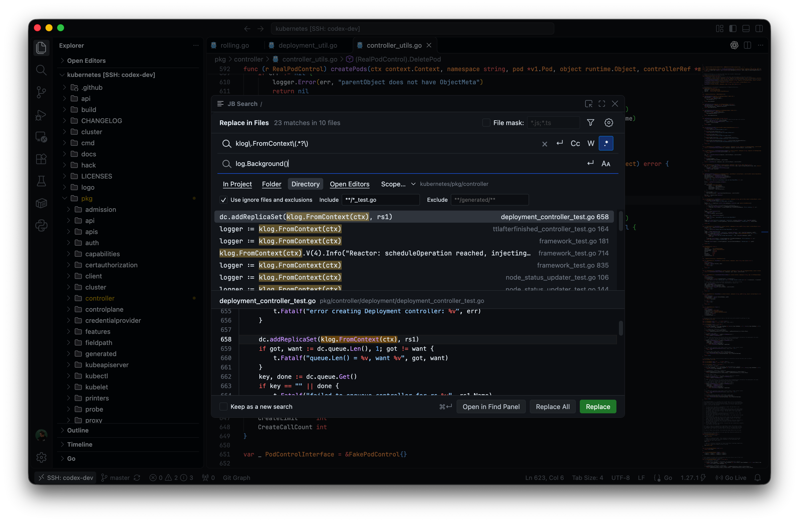

<div align="center">

# JB Search — JetBrains-style Find & Replace

A familiar floating search workflow for Visual Studio Code.

**Free · Open Source · MIT License**

[](https://github.com/idfedorov09/jbsearch/actions/workflows/test.yml?query=branch%3Amaster)
[](https://github.com/idfedorov09/jbsearch/releases/latest)
[](#requirements--limitations)
[](LICENSE)

[](https://marketplace.visualstudio.com/items?itemName=idfedorov09.jbsearch)
[](https://github.com/idfedorov09/jbsearch)
[](https://github.com/idfedorov09/jbsearch/issues/new/choose)
[](https://t.me/tribute/app?startapp=dTvL)

[Changelog](CHANGELOG.md)

</div>



## Why JB Search?

If you are used to JetBrains IDEs, searching across a project in VS Code can feel
unfamiliar. JB Search brings the floating Find/Replace workflow to VS Code:
refine a query, inspect matching code, and navigate results without losing your
place. The dialog follows your VS Code theme, while the results panel opens files
in the regular editor for editing, language support, and Undo.

## Demo

### Floating Search Dialog

Search, filter files, and switch scopes in a movable, resizable dialog.



### Native VS Code Results

Inspect highlighted matches, then open the native Find panel to work through results.



### Replace Workflow

Preview a replacement, apply it, and use the editor's Undo to restore your changes.



## Features

- **Floating Find/Replace dialog** — a compact, movable and resizable dialog with
  colors and fonts from your active VS Code theme.
- **Live search preview** — matching snippets and a read-only code preview with
  TextMate syntax highlighting and highlighted occurrences.
- **Native VS Code results panel** — a folder/file/result tree with your client's
  file icons. Selecting a result opens the source in the active central editor group.
- **Regex and multiline search** — case and whole-word matching, regular expressions,
  multiline queries, file masks, and include/exclude filters.
- **Named search scopes** — Project, Folder, Directory, Open Editors, and custom
  scopes. Open Editors includes unsaved and untitled text buffers.
- **Find from Explorer** — start a search in a folder from its context menu.
- **Safe Replace & Undo** — replacements use VS Code edits and stay unsaved until
  you save them. Stale, unchecked, or incomplete results block unsafe replacements.
- **Remote SSH support** — searches run on the workspace host; an automatically
  installed client component supplies your local theme rules and TextMate grammars
  for the dialog preview.

## Installation

Install [JB Search from the Visual Studio Marketplace](https://marketplace.visualstudio.com/items?itemName=idfedorov09.jbsearch).

Or search for **JB Search** in the VS Code Extensions view
(`Cmd+Shift+X` / `Ctrl+Shift+X`).

For development, source registration, or a locally built VSIX, see
[CONTRIBUTING.md](CONTRIBUTING.md#setup-and-checks).

## Usage

Use `Cmd` on macOS and `Ctrl` on Windows/Linux:

| Action | Shortcut | Where |
| --- | --- | --- |
| Find in Files | `Cmd/Ctrl+Shift+F` | VS Code window |
| Replace in Files | `Cmd/Ctrl+Shift+R` | VS Code window |
| Open in Find Panel | `Cmd/Ctrl+Enter` | Search dialog |
| Insert a newline | `Shift+Enter` | Query or replacement field |
| Close the dialog | `Esc` | Search dialog |
| Open and focus the editor | `Cmd/Ctrl+Enter` | Find panel |
| Next / previous occurrence | `F4` / `Shift+F4` | Find panel |

The Command Palette also provides **JB Search: Find in Files** and
**JB Search: Replace in Files**. Use `Tab` / `Shift+Tab` to move between dialog
controls and `Space` to toggle an option. Double-click a result, or press `Enter`
while the results list has focus, to open the source at the matching range and
close the dialog.

To search inside a specific folder, right-click it in **Explorer** and choose
**JB Search: Find in Files…**. The dialog selects **Directory** and shows the
folder path, keeping your query, file masks, and options. The search includes
subfolders. This works on workspace roots and nested folders, including when
several resources are selected: it searches the folder where you opened the
context menu. Saved searches in the Find panel remain independent.

**Remote SSH** is supported. Install JB Search in the remote window; the required
client component is installed automatically when needed. Your theme does not
need to be installed on the server.

Use **Open in Find Panel** to keep a search. Results have a stable order and form
a snapshot: edits trigger revalidation, and occurrences that no longer match are
marked **INVALID**. Undo can restore them. **Rerun Search** rebuilds the snapshot
and discovers new matches. The **Edit Search** gear reopens that search's parameters;
**Keep as a new search** creates an independent session.

## Configuration

Configure limits and named scopes in **Settings → JB Search**. For example:

```json
{
  "jbsearch.scopes": [
    {
      "name": "Sources",
      "include": ["src/**"],
      "exclude": ["**/generated/**"]
    },
    { "name": "API", "root": "api", "include": ["src/**"] }
  ],
  "jbsearch.search.maxResults": 5000,
  "jbsearch.replace.prepareTimeoutMs": 60000
}
```

`jbsearch.search.timeoutMs` limits each worker search. The independent
`jbsearch.replace.prepareTimeoutMs` setting limits total document and file
preparation for a replacement, excluding the worker search. It defaults to
60000 ms and accepts 100–300000 ms. A timeout before submission applies no edit;
increase the preparation limit or narrow the scope when appropriate. An edit
already submitted to VS Code cannot be cancelled by this timer.

The optional `root` selects a workspace folder by its exact, case-sensitive name
(including aliases). Patterns are relative to that folder; omit `root` to search
all folders. Invalid or ambiguous folder names produce an error.

**Downgrading:** Older versions ignore `root` and may search all folders. Remove
rooted scopes or use **Folder** scope before downgrading.

File masks accept patterns such as `*.js;*.ts`, `src/**`, and `**/*.{js,ts}`.

Find/Replace shortcuts are enabled by default. Set
`jbsearch.keybindings.overrideFindInFiles` to `false` to disable both defaults,
or customize them in **Keyboard Shortcuts**. The JB Search setting includes
links to each command. A remapped default keeps its `when` condition unless you
remove it, so the setting continues to control that binding.

## Requirements & limitations

- **Desktop VS Code 1.143.1+** and a filesystem workspace are required. VS Code for
  the Web and virtual workspaces are unsupported.
- The floating dialog uses an internal VS Code command. Future compatibility is
  not guaranteed. `workbench.editor.useModal` must not be `off`; `some` is sufficient.
- The dialog's code preview is read-only and uses TextMate grammars. It does not
  embed semantic tokens or full editor features. Files opened from the Find panel
  use the regular editable VS Code editor and its language extensions.
- Regex uses **ECMAScript** semantics. Expressions written for Java or PCRE2
  may need changes. Regex replacement supports capture groups, named groups, and
  newline/tab escapes; with Regex disabled, replacement text is literal.
- File search supports **UTF-8**. Inputs identified as binary, including ZIP/DOCX
  and common image/document formats, are excluded from text search and do not by
  themselves block Replace All; their contents are not searched or replaced.
  Unsupported encodings, unclassified oversized inputs, and inaccessible files
  make results incomplete. Binary detection uses content signatures and a NUL-byte
  heuristic, so arbitrary bytes cannot always be classified perfectly: a text
  input can be mistaken for binary, and vice versa. The dialog shows aggregate
  binary-exclusion and incomplete-input warnings, not individual skipped paths.
  To review representative paths and reasons before replacing, use **Open in
  Find Panel**; its bounded list is not exhaustive. Symlinks are not followed.
  Replace All requires complete results for eligible text; narrow the scope or
  adjust limits when a search is incomplete.
- Saved searches live in memory and are cleared when the extension host restarts.
  Changes to closed files outside the editor may require **Rerun Search** to rebuild
  result positions.
- **macOS and Linux have been tested.** Windows is expected to work but has not yet
  been verified. Automated GUI checks cover Linux/X11.
- Recorded Remote SSH checks use Linux loopback. Connections between separate
  physical machines, WSL, Dev Containers, and Wayland remain unverified.

See the [implementation limits](docs/implementation-limits.md),
[Find/Replace test matrix](docs/testing/find-replace.md), and
[native Find panel validation](docs/testing/native-find-panel.md) for details.

## Privacy

JB Search runs searches in the workspace extension host. With Remote SSH, that
host is your remote server. It does not send search queries or file contents to
external search services and includes no extension telemetry or analytics.

The Remote client component exchanges theme rules and TextMate grammar resources
through VS Code commands. It does not receive your search queries or source files.
Search history is kept in memory rather than written to disk. The search executable
is bundled with the extension and is not downloaded when you run a search.

## Roadmap

Planned areas of development:

- More search scopes.
- Improved search history.
- Better navigation through results.
- Broader platform support and validation.
- Search and replace UX improvements.

These are development directions; specific features, priorities, and timing are
subject to planning. Suggest ideas and react to existing requests in
[GitHub Issues](https://github.com/idfedorov09/jbsearch/issues).

Release readiness and outstanding platform checks are tracked in the
[release checklist](docs/release-readiness.md).

## Contributing

Bug reports, reproducible examples, platform testing, and pull requests are welcome.
Start with [CONTRIBUTING.md](CONTRIBUTING.md). Development happens in `dev`;
`master` is the stable branch.

Please follow the [Code of Conduct](.github/CODE_OF_CONDUCT.md). To report an
undisclosed vulnerability privately, see the [Security Policy](.github/SECURITY.md).

Write and maintain all repository content in **English**, including documentation,
specifications, development and validation reports, code comments, and future
sections and examples. Architecture decisions live in [ADR](docs/adr/README.md),
while requirements and changes are tracked with [OpenSpec](openspec/README.md).

Extension artwork: [PNG icon](media/icon.png) and [SVG source](docs/artwork/icon.svg).

## Support development

If JB Search makes your daily work easier, you can support its development
with a donation via Tribute.

[](https://t.me/tribute/app?startapp=dTvL)

You can also star the repository, share JB Search with other developers, report
reproducible bugs, or help test it on your platform. Feedback about the search and
replacement workflow is always welcome.

## License

[MIT](LICENSE) © 2026 idfedorov09.
