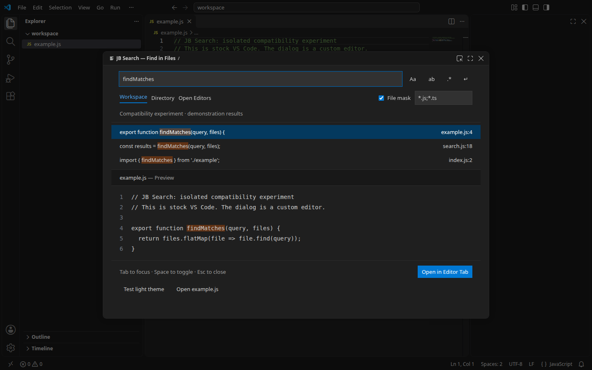

# Native floating dialog: feasibility study

Date: 2026-11-03. Research result, not an implemented JB Search feature.

## Conclusion

An ordinary extension installed from a VSIX in unmodified VS Code 1.144.1 can open
its own custom editor/webview in a native modal editor over the workbench. The
dialog can be moved and resized; Esc closes it; moving to a tab preserves the UI.
A separate application, proposed API, or installation patch is unnecessary.
However, **opening uses an internal command and internal group number**, rather
than a stable public Extension API contract.



The screenshot shows real VS Code and a custom editor. The results and preview
are demonstration data; this proves the container, not a finished search engine
or final UI.

## Tested environment

- Official stable Linux x64, `1.144.1`, commit
  `261c84cb1eddf11235f9e2c921425e9663fbe556`.
- The archive was obtained through the official update API; SHA-256 was verified:
  `59d8d6f9dc2431353c453cf6a4da0faae3993e332007ab387f526332eef93fe4`.
- Linux/X11 in Xvfb, with a 1440 × 900 window inside a 1440 × 1000 virtual screen.
- Separate user-data/extensions/workspace directories. The built probe VSIX was
  installed with standard `code --install-extension` and tested without
  `--extensionDevelopmentPath`. A Development Host was also tested separately.
- Playwright GUI automation over CDP was used only for observation, keyboard,
  mouse, and screenshots in the test instance. The extension does not connect to
  the debugger/inspector, inject code, or obtain the workbench DOM.
- `--no-sandbox` and `--disable-gpu` are launch flags for this containerized test
  environment, not extension requirements; the ordinary desktop sandbox was not
  tested in this experiment.
- macOS, Windows, Wayland, Remote, and the browser version were **not tested**.

## Mechanism

1. The manifest declares custom editor `jbsearchProbe.session` with priority `option`.
2. The public `registerCustomEditorProvider` registers a read-only CustomDocument
   for the session URI, `jbsearch-probe:/Find%20in%20Files.jbsearchprobe`. There is
   no actual session file on disk; the provider returns `{ uri, dispose() {} }`.
3. The extension command calls:

```js
await vscode.commands.executeCommand(
  '_workbench.openWith',
  sessionUri,
  'jbsearchProbe.session',
  [-4, { pinned: true, modal: { size: { width: 940, height: 650 } } }]
);
```

`-4` is the internal `MODAL_GROUP`, not a public `vscode.ViewColumn` value.
Public `vscode.openWith` transforms options, and `createWebviewPanel(..., -4)`
does not provide this route. They cannot be treated as equivalent substitutes
for the call.

Internal `_workbench.openWith` passes the group through `columnToEditorGroup`,
and `editorGroupFinder` creates a modal part when `workbench.editor.useModal != off`.
In the tested stable version, the default is `some`: the setting did not need
changing for the installed VSIX experiment. `all` is unnecessary and the product
must not enable it. `some` leaves ordinary files in tabs; VS Code itself opens
some system pages modally.

With `off`, this internal route **silently opens a tab**. A future adapter must
check the setting in advance and explain the limitation. It must not change it
silently or report the tab as successful opening of the required dialog. Even
enabling `some` affects system editor behavior; the choice stays with the user.

Moving uses `workbench.action.moveModalEditorToMain`. Native Esc from the webview
with focus in the input closed the dialog without a custom handler. A state object
in the extension host preserved the query after closing; closing itself destroyed
the view. Full sessions need a SessionController.

## Experiment results

Machine-readable report: [modal-editor-verification.json](modal-editor-verification.json).

| Check | Result |
| --- | --- |
| Ctrl+Shift+F in clean VS Code with the probe VSIX installed | Native modal over the current editor |
| Initial size | 940 × 650 |
| Dragging the title | (250, 125) → (320, 170) |
| Resizing the bottom-right corner | 940 × 650 → 1016 × 686 |
| Esc with query focus | Modal closed by VS Code's native handler |
| Reopening | Query `preserve this query` restored from host state |
| Dark Modern → Light Modern theme | Webview background changed from rgb(31,31,31) to rgb(255,255,255) |
| Open in Editor Tab | Modal closed; the same query is in a tab |
| Shortcut again from the tab | Session back in the modal |
| Opening an ordinary file from the modal | Modal closed; file in the main editor |
| `useModal: off` | No modal; fallback to a tab — guard required |
| No `useModal` setting override | Modal works; VSIX installation confirmed |

[Light theme during use](assets/modal-light.png).

The isolated experiment's source, VSIX, and helper scripts are in
`/tmp/jbsearch-window-research/`. These are temporary research files, not part of
the product; the VSIX and VS Code binary were not added to the repository.
Full verification of search, masks, regexp, preview, accessibility, and all three
operating systems is still ahead.

## Components and themes

The container, frame, drag/resize, system actions, and Esc belong to VS Code here.
The content is a webview: the public API does not export the workbench's internal
fields, lists, or TextEditor. The proposed UI library is `@vscode-elements/elements`,
a maintained third-party library that reproduces VS Code controls with Web
Components. It uses the `--vscode-*` CSS variables passed to webviews; it is not
an official package of internal widgets. The library was not installed for this
experiment: ordinary HTML controls with theme variables were used. The embedded
code preview remains a separate choice: a read-only renderer or separately
bundled Monaco, without automatic inheritance of all editor extensions and the
syntax theme.

Microsoft Webview UI Toolkit has been deprecated since 2025-01-01; using it as
the foundation of a new UI is not recommended. Persistent preferences can use
the actual native Settings UI through `contributes.configuration`.

## Approaches used by others

[IntelliJ Styled Search](https://marketplace.visualstudio.com/items?itemName=newdlops.intellij-styled-search)
was found with a very similar UX. Its
[source code](https://github.com/newdlops/intellij-styled-search) was inspected at
commit `7bb3716bef30bfda75ede08d8551118ba62000ae`: `overlayPanel.ts` connects to
the Electron inspector/CDP and uses `Runtime.evaluate`; the POSIX implementation
enables the inspector through SIGUSR1; a separate document describes Monaco
monkey-patching. This is an existing example, but it has a different level of
dependency on internals. It was neither run nor adopted. New modal editors allow
avoiding this injection and a separate application.

## Boundaries of the conclusion and next steps

- Modal editors were introduced in 1.110 as experimental. Only 1.144.1 was tested;
  this study **does not establish** a minimum compatible version. The main
  JB Search `engines.vscode` remains unchanged until implementation.
- Isolate the internal command and `-4` in one adapter. The command's existence
  alone does not prove modal support. Tests of selected stable versions, an
  accessible explanation of missing support, and migration to a public API when
  available are needed. Compatibility with future updates cannot be guaranteed.
- The UI is modal within the workbench; this route does not create a separate
  window in Alt+Tab. Background behavior, menus, IME, fullscreen, multiple windows,
  and restoration after restart still need checks on macOS, Windows, and Linux.
  Only Linux/X11 is proven.
- Shipping a separate Electron/Tauri application is no longer a necessary
  candidate. An ordinary VSIX and stock VS Code are achievable with the stated
  internal dependency. Accepting that dependency is separate from proving the
  mechanism.

## Sources

- [Official introduction of modal editors, VS Code 1.110](https://code.visualstudio.com/updates/v1_110#_modal-editors-experimental)
- [Current VS Code UI documentation](https://code.visualstudio.com/docs/editing/getting-started/userinterface)
- [Internal open command, source 1.144.0](https://github.com/microsoft/vscode/blob/1.144.0/src/vs/workbench/browser/parts/editor/editorCommands.ts#L545)
- [Group conversion](https://github.com/microsoft/vscode/blob/1.144.0/src/vs/workbench/services/editor/common/editorGroupColumn.ts#L18)
- [Modal group selection and setting](https://github.com/microsoft/vscode/blob/1.144.0/src/vs/workbench/services/editor/common/editorGroupFinder.ts#L143)
- [Native drag and resize](https://github.com/microsoft/vscode/blob/1.144.0/src/vs/workbench/browser/parts/editor/modalEditorPart.ts#L537)
- [Custom Editor API documentation](https://code.visualstudio.com/api/extension-guides/custom-editors)
- [Webview themes](https://code.visualstudio.com/api/extension-guides/webview#theming-webview-content)
- [VSCode Elements: purpose and limitations](https://vscode-elements.github.io/guides/getting-started/#what-is-vscode-elements)
- [Archived Microsoft Webview UI Toolkit](https://github.com/microsoft/vscode-webview-ui-toolkit)
