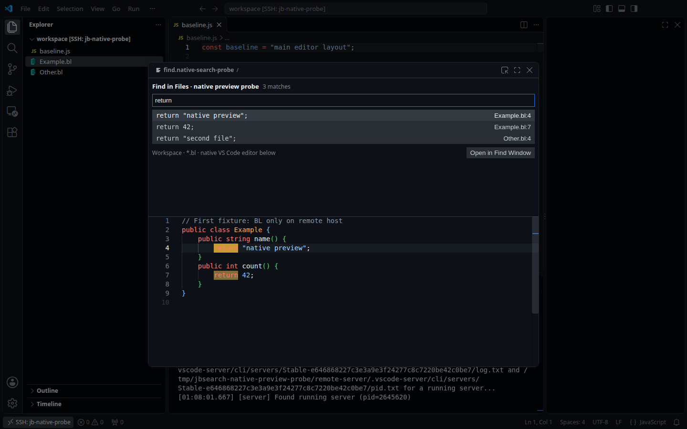

# Настоящий редактор в preview: проверка осуществимости

Дата: 2026-11-04. **Изолированный исследовательский прототип; в рабочий JB Search
не перенесён.** Пользователь согласовал проверку прототипа, а не смену архитектуры
поставляемого расширения.

## Вывод

Настоящий `TextEditor` удалось разместить под поисковой webview внутри одного
плавающего modal editor VS Code. Он автоматически использует клиентскую тему
GitHub Dark Default, хотя серверный extension host этой темы не видит. BL-код
подсвечивается, совпадения выделяются штатными decorations. Проблему отсутствия
темы на сервере этим действительно можно обойти.

Однако **найденная схема обновления preview непригодна для интерактивного поиска**:
она временно переводит фокус из query в native editor. При обычном вводе `return`
получилось `retrn`, а пропущенный символ попал в тестовый исходник. Read-only
снимок защищает исходник, но отдельно подтверждённая потеря символа запроса
сохраняется. Штатный перенос modal в main editor также не сохраняет составную
компоновку: поиск и preview становятся отдельными вкладками.

Это отрицательный результат конкретного адаптера с переключением фокуса,
**не доказательство невозможности любого native preview**. Внедрять его в рабочий
плагин, перехватывать глобальный ввод или скрыто менять `useModal` не следует.



Это техническая компоновка прототипа, не предлагаемый окончательный UI.

## Среда

- Официальный VS Code **1.143.1**, commit
  `e646868227c3e3a9e3f24277c8c7220be42c0be7`, Linux x64, X11/Xvfb.
- Настоящий Remote SSH к изолированному localhost-серверу; обычный workspace
  extension, зарегистрированный из исходной папки, без Development Host.
- Отдельные client user-data/extensions, server-data и синтетический workspace.
  Рабочий профиль пользователя не перезагружался и не менялся.
- **GitHub Theme 6.3.5** установлена только на клиенте. На сервере доступны
  probe и существующее расширение BL; его исходники использованы только для чтения.
- `serverSeesGitHubTheme: false`, `serverSeesBL: true`,
  `workbench.editor.useModal: some`. Proposed API в probe не включались.
- GUI-автоматизация Playwright/CDP использовалась только в тестовом экземпляре.
  Само расширение не получает доступ к DOM/inspector workbench.
- macOS, Windows, Wayland и Remote SSH по сети с существенной задержкой
  **не проверены**. Локальный loopback не подтверждает их поведение.

## Механизм и граница API

В modal открыта поисковая webview, затем через `vscode.setEditorLayout` созданы
две вертикальные editor groups. Верхняя содержит query/results, нижняя — настоящий
текстовый редактор. Номера групп определяются по вкладкам, а не фиксируются как
`ViewColumn.One/Two`: в стенде основная группа имеет column 1, search — 2,
preview — 3.

Обычный `showTextDocument({ viewColumn, preserveFocus: true })` не обеспечивает
открытие в нижней modal-группе: при `useModal: some` VS Code перенаправляет такую
группу в main editor. Явный внутренний `MODAL_GROUP = -4` пропускает эту защиту,
но выбирает **активную** группу modal part. Поэтому проверенный адаптер использует:

```js
await vscode.commands.executeCommand('workbench.action.focusBelowGroup');
await vscode.commands.executeCommand('_workbench.open', previewUri, [-4, {
  preserveFocus: true,
  pinned: false
}]);
// Найти TextEditor, поставить decorations и показать выбранный диапазон.
await vscode.commands.executeCommand('workbench.action.focusAboveGroup');
await searchWebview.postMessage({ type: 'focus' });
```

`preserveFocus` здесь сохраняет **уже изменённый** фокус. Возврат после команды
не восстанавливает клавиши, отправленные в native editor между этими действиями.
Debounce и очереди запросов не гарантируют, что пользователь не продолжит набор
во время обновления preview. Проверенный внутренний маршрут не даёт отдельного
селектора неактивной modal-группы; существование другого пригодного маршрута
не установлено. Внутренние `_workbench.openWith`, `_workbench.open` и `-4`
не становятся стабильным публичным API от того, что probe работает без proposed API.

Проверены два режима: исходный URI с редактируемым настоящим документом и
`TextDocumentContentProvider` с read-only URI `jb-native-snapshot:`. Во втором
режиме источник снимка — актуальный `TextDocument.getText()`, включая несохранённые
правки; после назначения языка `bl` применяется штатная TextMate-подсветка.

## Подтверждённые результаты

| Проверка | Результат |
| --- | --- |
| Search webview и native BL editor в одной modal | Две группы внутри одного диалога |
| GitHub Dark Default только на клиенте | Keyword `return` имеет цвет `rgb(255, 123, 114)` при `serverSeesGitHubTheme: false` |
| Выбранное и остальные совпадения | Штатные decorations присутствуют поверх syntax colors |
| Выбор другого результата | Native preview переключается между двумя удалёнными BL-файлами |
| GitHub Dark Default → Light Modern → обратно | Цвет keyword меняется на `rgb(175, 0, 219)` и возвращается без собственного theme bridge |
| Попытка печатать в read-only snapshot | Длина/dirty-state снимка и исходники не меняются |
| Несохранённая правка исходника | Снимок и видимые строки обновляются; исходник dirty, снимок clean, диск не меняется |
| Обычный набор `return`, 140 мс между символами | Получено `retrn`; исходный preview становится dirty, закрытие вызывает save confirmation |
| Символ `n` через 2 мс после blur в snapshot-режиме | Ожидалось `return`, получено `retur`: read-only не спасает ввод запроса |
| Чистый перенос modal во вкладку | Search и snapshot — отдельные tabs в одной выбранной main-группе |
| Очистка стенда | Dirty fixtures отменены без сохранения; осталась чистая вкладка `baseline.js` |

Протокол обычного ввода:
[native-preview-results-source.json](native-preview-results-source.json).
В нём 4 успешные проверки, 1 подтверждённое ограничение и 7 ошибок. Эти ошибки
**не являются семью независимыми дефектами**: после повреждения query результаты
исчезли, а затем save confirmation нарушил дальнейшие проверки. Ошибки выбора
строк, reopen и количества dialogs нельзя трактовать независимо от этого состояния.

Отдельный чистый прогон snapshot:
[native-preview-results-snapshot.json](native-preview-results-snapshot.json) —
5 успешных проверок, 2 подтверждённых ограничения, 0 неожиданных ошибок.
Здесь read-only, несохранённый текст, цвета, потеря ввода и перенос проверены
отдельно после очистки состояния. В тесте обновления текста нормализованы
неразрывные пробелы DOM Monaco; выбор документа определяется по фактическому URI.

Дополнительные снимки:
[save confirmation после попадания символа в исходник](assets/native-preview-input-loss.png),
[перенос на чистом состоянии](assets/native-preview-move-to-tab.png).

## Что это меняет в выборе архитектуры

Грамматика BL и GitHub Dark Default не являются причиной отсутствия цветов:
проверка этой же грамматики с клиентской темой дала настоящую syntax-подсветку.
Нативный редактор решает доступ к клиентскому оформлению, но найденный способ
его размещения нарушает сохранность ввода и требуемую единую вкладку поиска.

Read-only snapshot также не равнозначен исходному документу для всех языков:
другая URI-схема может исключить semantic providers. Здесь проверены BL/TextMate,
не полнота semantic highlighting всех языковых расширений.

Для дальнейшего обсуждения остаются отдельные варианты:

1. Найти способ обновлять неактивную modal-группу **без смены фокуса**, затем снова
   проверить ввод, вкладку и платформы. Пригодный маршрут пока не найден.
2. Сохранить существующий единый webview и передавать правила клиентской темы
   небольшим локальным UI extension серверной части через команды VS Code.
   Это поддерживаемый межхостовый канал без собственного SSH/сокетов, но два
   технических extension ID, отдельная регистрация на клиенте и ещё не проверенный
   сценарий установки/обновления. Требуется обработать includes, пользовательские
   token customizations, смену темы и отсутствие локальной части. Передача темы
   сама по себе не даёт все semantic tokens и клиентские grammars.
3. Дождаться стабилизации API готовой syntax-подсветки. В проверенной 1.143.1
   `computeFullSyntaxHighlighting` ещё относится к proposed
   `documentSyntaxHighlighting`; это не решение для обычной стабильной поставки.

Выбор следующего варианта и production-реализация этим исследованием не одобрены.
Задачи OpenSpec 4.6 и 5.3 остаются открытыми; baseline specs не синхронизированы.

## Воспроизведение и артефакты

Исходники и GUI runner изолированного probe:
`/tmp/jbsearch-native-preview-probe/extension.js`, `verify.cjs`,
`verify-snapshot.cjs`. Они не входят в поставку JB Search. Исходный suite
зафиксировал source input loss; snapshot runner отдельно начинает с `reset`,
проверяет read-only и заканчивает отменой изменений только синтетических fixtures.
Результаты и снимки скопированы в этот каталог до остановки тестового экземпляра.

После обновления исследовательских документов прошли `npm run check`, все
52 текущих `npm test`, `npm run spec:check`, `git diff --check` и проверка локальных
Markdown-ссылок. `node --check` прошёл для probe и snapshot runner. Это проверка
репозитория и прототипа, не подтверждение исправления production preview.
VSIX в этой итерации не пересобирался: поставляемый код и manifest не изменялись.

## Первичные источники

- [Выбор группы, modal redirect и activeGroup в VS Code 1.143.1](https://github.com/microsoft/vscode/blob/e646868227c3e3a9e3f24277c8c7220be42c0be7/src/vs/workbench/services/editor/common/editorGroupFinder.ts)
- [Штатный перенос и merge modal-групп](https://github.com/microsoft/vscode/blob/e646868227c3e3a9e3f24277c8c7220be42c0be7/src/vs/workbench/browser/parts/editor/modalEditorPart.ts)
- [Read-only virtual documents и обновление содержимого](https://code.visualstudio.com/api/extension-guides/virtual-documents)
- [Команды между UI и workspace extensions](https://code.visualstudio.com/api/advanced-topics/remote-extensions#communicating-between-extensions-using-commands)
- [Контракт proposed syntax highlighting](https://github.com/microsoft/vscode/blob/e646868227c3e3a9e3f24277c8c7220be42c0be7/src/vscode-dts/vscode.proposed.documentSyntaxHighlighting.d.ts)
- [Manifest клиентской GitHub Theme 6.3.5](https://github.com/primer/github-vscode-theme/blob/v6.3.5/package.json)
