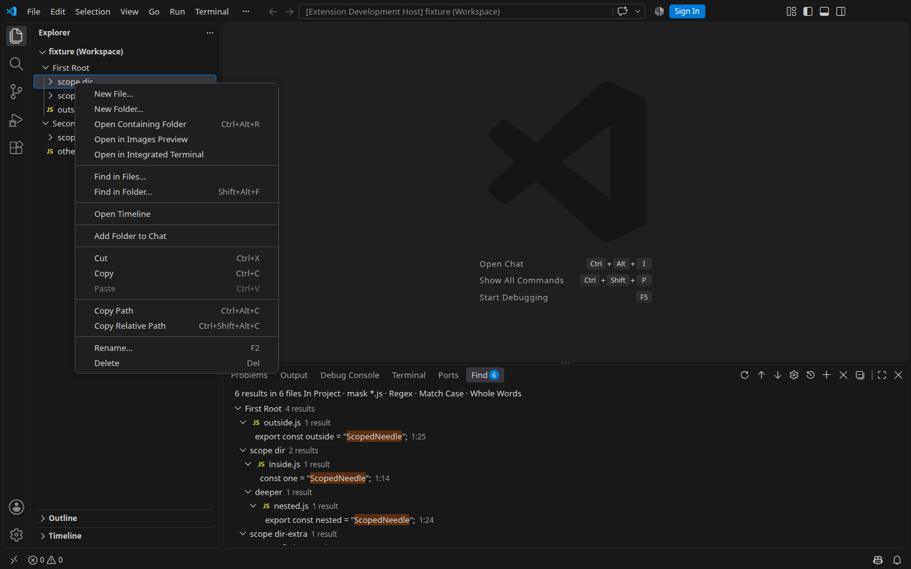
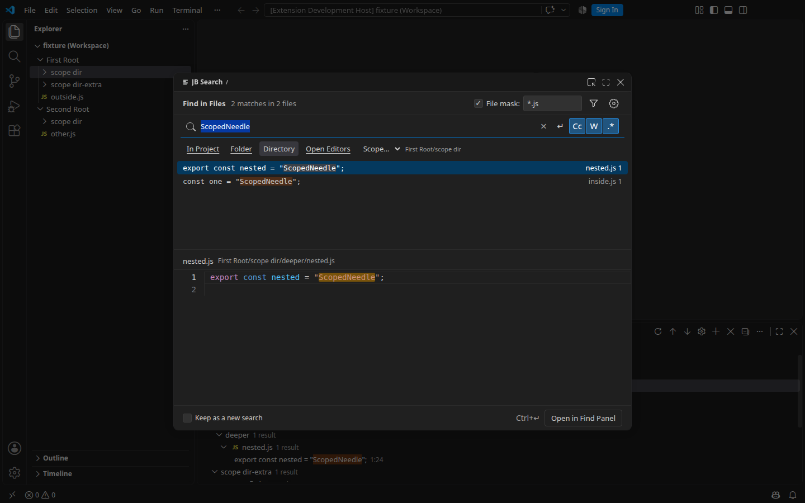

# Find in Files из Explorer — 0.2.0

Дата проверки: **4 ноября 2026**. Основное расширение — **0.2.0**,
вложенный UI client — **0.1.0** без изменений кода и протокола.

## Поведение

ПКМ по одной папке Explorer → **Find in Files…** открывает существующий
Find-диалог. Выбрана область Directory и точный путь папки; поиск включает
подпапки, сохраняет запрос, маски и опции. Поддерживаются корни workspace
и выбор папки второго root. Пункт скрыт у файлов и при multiselect.

Сохранённые Find-поиски и их gear drafts не перезаписываются: контекстный запуск
создаёт независимый поиск. Ошибка URI/stat или выполняющаяся замена не меняют
область текущего поиска. Поздние результаты и завершившаяся позже проверка
предыдущей папки не перекрывают последний запрос.

## Автоматические проверки

Изолированный снимок собственных staged изменений задачи:
`9a6d76aa30e844efb57822ddb9736861257a8d42`. Отдельный временный каталог,
Node.js **22.23.2**, npm **12.0.2**, Linux x64. Параллельное незакоммиченное
оформление README не вошло в снимок и VSIX.

- `npm ci` — успешно, вложенный клиент подготовлен из исходников.
- `npm run check` — успешно.
- `npm test` — **180/180**, включая **17** вложенных subtests;
  без failures, skips или cancellations.
- `npm run spec:check` — **10/10** объектов снимка.
- `npm run package` — успешно. Основной VSIX содержит **73** файла,
  вложенный клиент — **31**; identity, версии, client build, runtime-зависимости,
  PNG и ripgrep для всех поставляемых платформ проверены verifier.

Пакет: **24 345 772 байта**, SHA-256
`8e8243367abdc6dcfd10cb451ae05739b25f6adf8565eed3c374ffb40d9a3ffd`.
Полный отчёт: [explorer-find-package-results.json](explorer-find-package-results.json).
VSIX генерируется локально и не включается в Git.

## Реальный VS Code: исходники

**VS Code 1.143.1, Linux x64 / X11 / Xvfb**, отдельный профиль и
Extension Development Host. Автоматизированный GUI-прогон — **8/8**:

- Обычный Find открывает прежний modal с Project; базовый поиск даёт шесть
  совпадений в двух roots с Match Case, Whole Words, regex и `*.js`.
- Настоящий клик по action в меню вложенной `scope dir` открывает Directory
  с двумя совпадениями; `scope dir-extra` и второй root исключены.
- Запрос и опции сохранены; исходный Find-снимок не меняется после открытия
  нового поиска и Esc.
- Action на корне workspace даёт четыре совпадения только этого root.
- Перенос Directory-поиска в Find Panel создаёт независимую сохранённую сессию.
- Action отсутствует в меню файла и двух выбранных папок.
- Обычный Ctrl+Shift+F сохраняет прежнюю область, даже если Explorer сфокусирован
  на другой папке; отменённый gear draft не изменяет исходный снимок.

Детали и фактические состояния:
[explorer-find-source-results.json](explorer-find-source-results.json).
Скриншоты просмотрены отдельно; в них только тестовые fixtures.

## Границы и ручная приёмка

Это проверка настоящего VS Code с управлением через Playwright, а не ручная
приёмка всех платформ. macOS, Windows и физический Remote между разными
машинами этим прогоном не проверены. Видимость `vscode-remote` в menu guard
и проверка файлового URI workspace host покрыты кодом и unit-тестами;
это не подтверждение физического Remote SSH.

- [ ] На macOS и Windows: ПКМ по папке/корню → Find in Files… → правильные
  Directory, focus и результаты; проверка Esc и обычных Find/Replace shortcuts.
- [ ] В физическом Remote: тот же путь из Explorer; поиск идёт на workspace host,
  а не по одноимённому локальному пути. Проверить client theme/preview.

Публичная публикация и перенос в master не входят в эту поставку.
