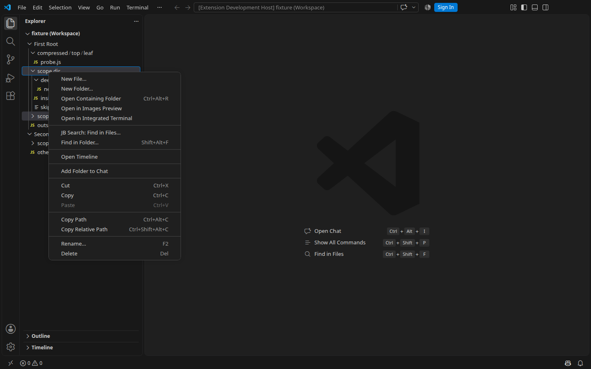
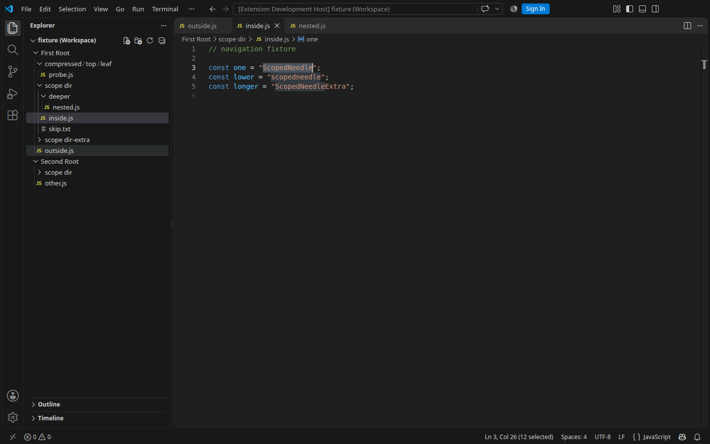

# Explorer menu and result navigation — 0.2.1

Validation date: **November 4, 2026**. Main extension **0.2.1**,
nested UI client **0.1.0**, with unchanged client code and protocol.

## Corrected behavior

**JB Search: Find in Files…** remains in a folder's context menu when Explorer
retains multiple selected resources. Directory uses the folder where the menu
was opened; other selected resources are not added to scope. The prefix
distinguishes it from built-in **Find in Folder**. It remains hidden on files
and unsupported filesystems.

Double-clicking a snippet or filename, or pressing Enter in the Find/Replace
results list, opens the source at the matching range. The controller checks
result validity, waits for modal closure, and focuses the central TextEditor.
No new editor groups are created. A changed result refreshes search; a closure
failure leaves the dialog available. If opening the editor fails after modal
closure, a native VS Code notification reports the error.

## Source and packaging checks

Isolated staged Git tree snapshot:
`02068093d6184dc80bc6c1dc69d054daff24c3cb`. Node.js **22.23.2**,
npm **12.0.2**, Linux x64. Validation logs were kept outside the packaging
directory; generated VSIX files stay out of Git.

- `npm ci` passed; the nested client was prepared from source.
- `npm run check` passed.
- `npm test`: **195/195**, including 17 nested subtests; no failures, skips, or
  cancellations. Coverage includes DOM stability between clicks, virtualization,
  Enter, generation guards, stale results, refused modal closure, and source
  opening failures.
- `npm run spec:check`: **13/13**; after behavior validation, the main
  `search-entry-points` spec was synced with the 0.2.1 delta and validated again.
  Changes were not archived.
- `npm run package` and verifier passed: **73** main package files, **31** nested
  client files. Checks cover identity, versions, client build, runtime dependencies,
  PNG, and executable ripgrep for all distributed platforms.

VSIX size: **24,360,724 bytes**, SHA-256:
`c8cbfe678c7372e58fab1764891e000cdbddd8babe6f6a9fdc21a06cbf0b2489`.
Reports: [checks](explorer-navigation-checks.json),
[package](explorer-navigation-package-results.json).

## Actual VS Code

GUI controlled through Playwright on Linux x64 / X11 / Xvfb in separate
temporary profiles:

- **VS Code 1.143.1**, sources through Extension Development Host: **12/12**.
- **VS Code 1.144.1**, installed VSIX 0.2.1: **12/12**. Main loaded from
  `extensions/idfedorov09.jbsearch-0.2.1`; the source project was not connected
  as a development extension. A separate probe reads the installed controller's
  state; runtime files and manifest were compared with the package.

Both runs checked:

- A distinct title beside built-in Find in Folder.
- Two selected folders and mixed file/folder selection: the menu item remains,
  scope uses the context folder, and neighboring folder results are excluded.
- Each of three compressed folder segments passes its own path.
- The item is absent on a file.
- Double click on selected/other snippets and filenames; for other results, a
  host selection echo was deliberately processed between clicks. The original
  DOM target remained connected.
- Replace opens source without applying a replacement; Enter works in both modes.
- Correct URI and exact range, including `[2,13 → 2,25]`; modal closed,
  TextEditor active with DOM focus, and one central editor group retained.

Full states: [source](explorer-navigation-source-results.json),
[installed](explorer-navigation-installed-results.json).
Screenshots were reviewed and contain only test fixtures.

On previous installed 0.2.0, menu disappearance was reproduced with multiselect
because of `!listMultiSelection`. Old double click passed on Linux with delays
of 0/50/150/300 ms: this run did not reproduce the user's exact macOS failure.
The confirmed DOM recreation between clicks and modal-close/editor-open order
were corrected and covered by tests.

## Validation boundaries

This is an automated actual VS Code run, not manual acceptance of macOS,
Windows, or physical Remote SSH. Those environments need separate checks.
Successful nested client and `vscode-remote` guard validation does not replace
Remote validation between separate machines.

Publication, transfer to master, tags, and releases are outside this delivery.

## Git and CI

Fixes were sent by normal push to `origin/dev` in commit
`d657bfdb6f30e60d059afe5ec9783d576518579e`
(`fix: stabilize Explorer search menu and result navigation`). Remote and local
SHAs matched; the working tree was clean after the commit.

[GitHub Check #41825516841](https://github.com/idfedorov09/jbsearch/actions/runs/41825516841)
completed successfully at **2026-11-04T12:00:36Z**: clean install, check,
**195/195** tests, **13/13** OpenSpec checks, package, and verifier. The test's
VS Code/Xvfb processes were stopped. This report and the OpenSpec completion
mark are recorded in a subsequent documentation commit; runtime and VSIX are unchanged.
