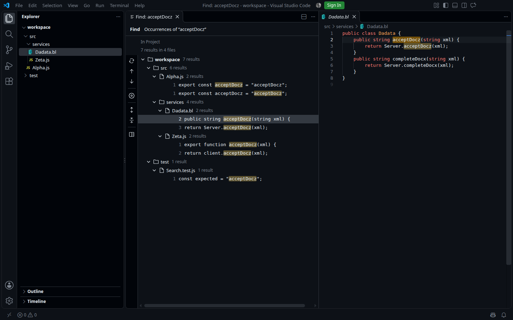
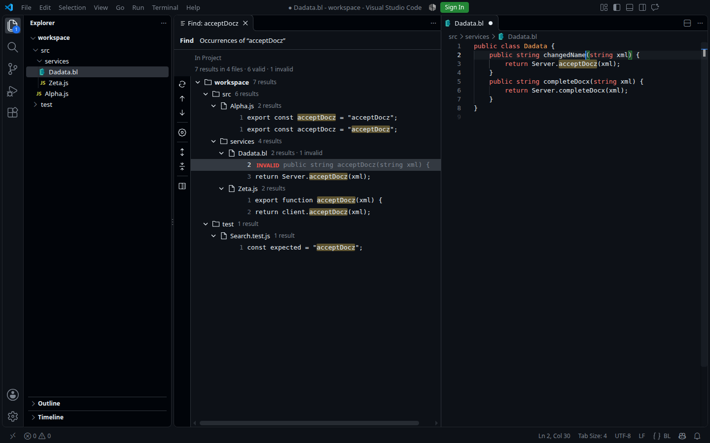

# Find Window validation

Historical report for the former HTML tree and right editor group. After the
move to the native bottom panel, current results are in
[native-find-panel.md](native-find-panel.md); the placement below is no longer used.

Date: **November 4, 2026**, extension **0.1.0**, branch `dev`.
Change: [implement-find-window](../../openspec/changes/implement-find-window/proposal.md),
decision: [ADR 0007](../adr/0007-find-window-and-native-editor.md).

The separate results mode was tested: a tree in a Find tab, an actual editor on
the right, a stable snapshot with INVALID, returning to parameters, and replacements.
The floating dialog retains its own read-only preview. Earlier modal and client
theme bridge checks are in [find-replace.md](find-replace.md).

## Final checks

| Check | Result |
| --- | --- |
| `npm run check` | Passed |
| `npm test` | **141/141**, no skipped/cancelled tests |
| `npm run spec:check` | Passed, all 4 items |
| `npm run package` | Main and nested VSIX verified |
| Complete product from source | **16/16 GUI scenarios** |
| Complete product from installed VSIX | **16/16 GUI scenarios** |
| Native preview adapter | Desktop VS Code **1.143.1 and 1.144.1** |
| Browser tree layout | Dark/light/high contrast, narrow Replace, 5000 results |

Complete GUI runs were automated in normal **stock desktop VS Code 1.144.1**,
Linux x64, X11/Xvfb, through Playwright. This was not an Extension Development Host.
Separate user-data/extensions directories and a synthetic workspace were under
`/tmp/jbsearch-find-window-product-check`. The user's working profile was unchanged.

In the first run, the main extension was registered from the source folder as a
resource. In the second, the final VSIX was installed through the standard CLI
into a separate directory; actual loading from
`packaged-extensions/idfedorov09.jbsearch-0.1.0` was confirmed. Both runs used
GitHub Theme **6.3.5** (GitHub Dark Default and GitHub Light Default), BL extension
**1.5.1**, and synthetic BL/JS files. The BL extension was read from the neighboring
source folder without changing its files. A test probe observed public editor
state and the controller model; user actions used the actual UI and keyboard.
The probe is not distributed with the product.

## Complete GUI run

Each scenario below passed from source and installed package:

| # | Scenario and observed behavior |
| --- | --- |
| 1 | Ctrl+Shift+F opens the modal; `acceptDocz` finds 7 occurrences in 4 files |
| 2 | Open in Find Window opens a separate tree without the query form, Open in Find Window button, or bottom HTML preview; actual `Dadata.bl` on the right has language `bl` |
| 3 | Typing in the actual BL editor retains the result row as INVALID with its IDs, order, and generation; the edit is unsaved and the on-disk file unchanged |
| 4 | Ctrl+Z restores validity of the same occurrence with the same ID |
| 5 | Inserting a line before a result shifts coordinates; a new match is not added until Rerun; rerunning gives 8 rows in consistent order |
| 6 | The gear opens parameters; changing the query and pressing Esc preserves the original snapshot and releases the closed draft |
| 7 | Confirming `completeDocx` with mask `*.bl` updates the same tab to 2 results; the mask appears in the summary |
| 8 | After parameter changes, Enter opens the visibly selected new result even if focus was at the end of the tree beforehand |
| 9 | New Tab creates an independent `acceptDocz` search; the previous `completeDocx` tab remains |
| 10 | Rapid selection changes leave the last file on the right; navigation retains tree focus |
| 11 | Switching to GitHub Light Default and back to Dark changes the UI and actual editor |
| 12 | Ctrl+Shift+R opens a Replace draft of the current Find tab; confirmation changes that same tab to Replace |
| 13 | Single replacement leaves INVALID; Replace All is blocked; Undo restores the row; Replace All then leaves both results INVALID and the document unsaved |
| 14 | Rerun removes vanished rows; Esc does not close a normal Find tab |
| 15 | Closing a Find tab releases its snapshot; later edits do not restore the closed search, while another tab keeps working |
| 16 | Reload Window restores the separate tree renderer; query/result history intentionally resets |

Machine-readable reports: [sources](find-window-source-results.json) and
[installed package](find-window-installed-results.json).
JSON times are UTC; the run date in Europe/Moscow was November 4, 2026.

Also available: [light theme](assets/find-tree-native-light.png) and
[Replace after edits](assets/replace-invalid-dark.png).

## Unit and browser checks

New suites: range model **17**, native preview **13**, Find UI **15**, and Find
Window controller **17** tests. These are included in the overall **141/141**.
Checks cover UTF-16/CRLF/multiline, insertion/deletion/Undo, stable IDs, regex
context and captures, unavailable files, validation errors, cancellation and late
replies, isolated draft/Cancel/New Tab, transfer with rollback on opening failure,
renderer recovery from `uri.query`, background sessions, and replacement guards.
Separate checks cover releasing a closed Find, transfer when the modal closes
before tab resolution, and keyboard focus synchronization after a new run,
initial batches, and final sorting. Regressions also cover a closed native editor,
mask from UI options, and paths with encoded `#`, `?`, and `%`.

Browser validation loads the production tree HTML/JS/CSS in Chromium with synthetic
theme variables and host messages. It does not replace the product run. Checks
cover dark/light/high contrast at 980×700, Replace at 390×420, no overlap of main
controls, selection/Enter/double click/collapse, and Replace All blocked with
INVALID/pending. For 5000 occurrences, **32 rows** remained in the DOM; navigation
to `long-4999` was correct, with a 120072 px canvas and 119464 px scroll. No page
errors. [Browser report](find-window-browser-results.json).

A separate native adapter desktop probe in **1.143.1** and **1.144.1** checked a
new group specifically on the right with `openSideBySideDirection: down`, retaining
existing dirty tabs, editing/Undo, preserveFocus, a collapsed caret, and updating
only decorations without moving it. Exact environment and API references are in
[ADR 0007](../adr/0007-find-window-and-native-editor.md) and the
[adapter summary](find-window-native-adapter-results.json).

In both versions, computed fill alpha was **0.351373** for `#ff000080` and **0.28**
for `#00ff0066`; after changing to `#0000ff40`, it was **0.175686**. These are 70%
of the original alpha after color rounding. Syntax token foreground/opacity was
unchanged; a missing border received a transparent fallback. Reports:
[1.143.1](find-window-native-alpha-143-results.json),
[1.144.1](find-window-native-alpha-144-results.json).

## Distribution and source updates

[Package validation](find-window-package-results.json): main VSIX **73 files,
24,330,825 bytes**. Checks cover the new controller/model/adapter/HTML/JS/CSS,
runtime dependencies, and ripgrep binaries for all 12 distributed platforms,
including executable mode for Unix. Binary presence does not prove launch on
that OS. The nested client VSIX has **31 files, 82,935 bytes**; build
`f3ce5f362b4ed3364b9f13a89b949ac196c9180e2e03360b67702bd6d32ed4ab` is unchanged.
Checks confirm the nested package matches the prepared helper, its metadata, and
runtime dependencies. The main package SHA-256 is in JSON.

The version remains **0.1.0**. A registered source folder needs only
**Developer: Reload Window**; these server changes do not require reinstalling
the extension or client. A separately installed VSIX copy needs a new package.
Commits, push, Marketplace, and changes to the working profile were outside
this validation.

## Controls and practical boundaries

- Single selection retains tree focus. Enter, double click, and Focus Preview
  Editor move focus to code. Up/Down/Home/End/PageUp/PageDown move selection;
  Left/Right/Space control groups; F4/Shift+F4 navigate occurrences. Expand All,
  Collapse All, Rerun Search, and Edit Search are available.
- The right side is an **editor group**, not the literal **Secondary Side Bar**.
  Public API cannot place an actual TextEditor in a sidebar. This explicitly
  differs from the desired placement; the editor retains normal language features.
- Tree rows show plain snippets with match highlighting. Full syntax highlighting
  is in the actual editor. Semantic token and client TextMate bridge limits apply
  to the floating dialog's preview.
- A snapshot is fixed after search completes. An edit during the full running
  search restarts its construction. Afterward, new rows appear only with Rerun;
  edits update positions and status of existing rows.
- An externally changed closed file without TextDocumentChangeEvent lacks the
  original edit geometry needed for exact range shifts. Current coordinates are
  checked; a mismatch shows INVALID. Rerun rebuilds all results.
- File validation can fail, time out, or hit a limit. Its rows remain Checking
  with an explanation; stale replacements are blocked. Validation is limited to
  50000 matches and common time/size settings. Undo history keeps 128 coordinate
  states and the initial state, without storing the complete text.
- Temporary query/results do not survive an extension host restart. Reload Window
  restores the Find tab type; the search can then be entered again through the gear.
- The complete new Find Window was tested on **Linux/X11, VS Code 1.144.1**.
  Adapter validation on 1.143.1 is not a full product run on that version.
  macOS, Windows, WSL/Containers, and physical Remote between separate machines
  were not included. Earlier modal Remote loopback validation is documented
  separately and does not prove this Find Window in Remote.
