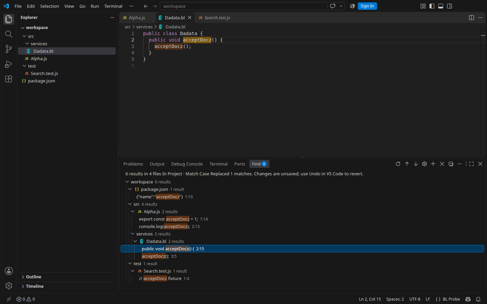
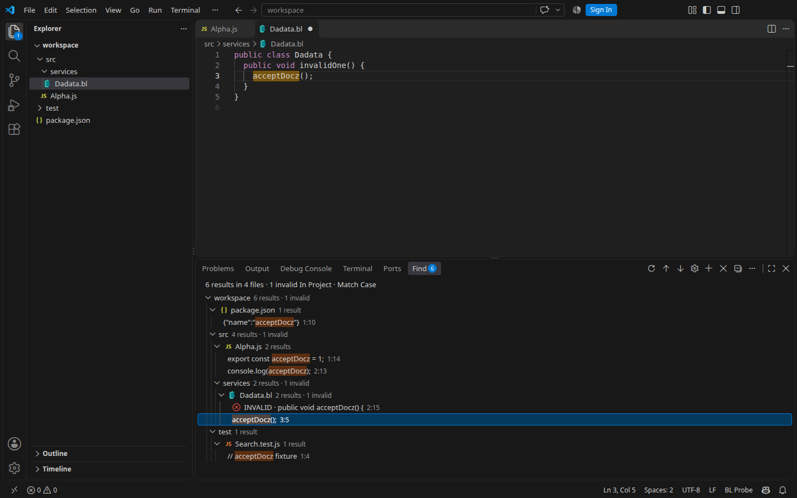

# Проверка штатной Find Panel

Дата: **4 ноября 2026**, расширение **0.1.0**, ветка `dev`.
Изменение: [use-native-find-panel](../../openspec/changes/use-native-find-panel/proposal.md),
решение: [ADR 0008](../adr/0008-native-find-panel.md).

Результаты перенесены из центрального HTML-дерева в штатную нижнюю панель Find.
Иконки файлов и каталогов рисует workbench, клик по вхождению открывает настоящий
редактор в текущей центральной группе без split. INVALID получил префикс перед
сниппетом и значок ошибки в цвете активной темы. Этот протокол заменяет проверку
размещения из [find-window.md](find-window.md); прежние проверки modal и клиентского
канала темы остаются в [find-replace.md](find-replace.md).

## Среда и результаты

| Проверка | Результат |
| --- | --- |
| `npm run check` | Успешно |
| `npm test` | **145/145**, без skipped/cancelled |
| `npm run spec:check` | Все 5 объектов прошли строгую проверку |
| `npm run package` | Основной и вложенный VSIX проверены |
| Исходники, VS Code **1.143.1** | **13/13 GUI-сценариев** |
| Установленный VSIX, VS Code **1.144.1** | **13/13 GUI-сценариев** |
| Иконки Find против Explorer | **10/10 сравнений** в каждом прогоне |

GUI проверен автоматизированно через Playwright в stock desktop VS Code на
**Linux x64, X11/Xvfb**. Это реальные окна VS Code, а не браузерная копия UI.
Первый прогон — Extension Development Host с основным расширением из исходников;
второй — обычное окно с основным VSIX и тестовым помощником, установленными через
штатный CLI. Фактический путь основного расширения во втором прогоне указывал на
`extensions/idfedorov09.jbsearch-0.1.0`; controller, provider и preview совпали с
исходниками, manifest — с исходным после исключения метаданных установщика.

Использованы отдельные каталоги user-data/extensions и синтетические workspace
в `/tmp/jbsearch-native-panel-check` и `/tmp/jbsearch-native-panel-installed-check`.
Запрос `acceptDocz` даёт **6 совпадений в 4 файлах**: JS, JSON и BL. BL здесь —
минимальная тестовая grammar и language icon, скопированная из языкового расширения.
Проверка не является полным прогоном реального BL language server или semantic
tokens. Исходники BL-расширения и рабочий профиль пользователя не менялись.

Машиночитаемые протоколы: [исходники](native-find-panel-source-results.json),
[установленный VSIX](native-find-panel-installed-results.json) и
[состав пакета](native-find-panel-package-results.json).

## GUI-сценарии

Каждый сценарий прошёл в обоих вариантах поставки:

| № | Проверенное поведение |
| --- | --- |
| 1 | Open in Find Panel закрывает modal, показывает нижнюю Find с 6 результатами и передаёт фокус дереву; исходный Alpha.js остаётся открыт, editor group одна |
| 2 | Клик по BL-вхождению открывает Dadata.bl в центральной группе, сохраняя фокус дерева; Ctrl+Enter фокусирует и закрепляет редактор; видны разные цвета syntax tokens и заливки совпадений |
| 3 | Иконки JS, JSON, BL и двух каталогов совпадают с Explorer в Seti и custom probe icon theme; смена темы изменяет обе области |
| 4 | Light Modern и возврат к Dark Modern меняют оформление workbench без смены поиска, исходника или количества editor groups |
| 5 | Шестерёнка открывает отдельный draft; изменение query и Esc сохраняют исходные параметры и снимок |
| 6 | Подтверждение draft с Match Case обновляет тот же поиск |
| 7 | Keep as a new search создаёт независимый поиск; штатный QuickPick переключает сохранённые снимки |
| 8 | Hide Panel сохраняет сессии; Close Search освобождает только выбранную |
| 9 | Replace открывается через тот же modal и после подтверждения сохраняет ID выбранного поиска и replacement |
| 10 | Правка исходника оставляет INVALID на прежнем месте с прежним ID; видны префикс и красный значок ошибки |
| 11 | Replace All при INVALID заблокирован; Undo восстанавливает тот же результат и убирает префикс со значком |
| 12 | Стрелка перемещает фокус, Enter активирует вхождение; F4 переходит к следующему; одиночная замена меняет выбранный BL-результат, а Undo его восстанавливает |
| 13 | Rerun увеличивает generation и пересчитывает выдачу, сохраняя открытый документ и одну центральную группу; совпадения остаются выделены |

Дополнительно: [светлая тема](assets/native-find-panel-light.png) и
[сравнение custom icons с Explorer](assets/native-find-panel-icons.png).

В Dark Modern значок ошибки невыбранной строки имеет цвет `rgb(248, 81, 73)`
из `errorForeground`. У выбранной строки workbench переопределяет его для
контраста: в проверке получилось `rgb(204, 204, 204)`. Форма значка и префикс
INVALID сохраняются. Свои CSS для обхода правил native selection не добавлены.

## Особенности тестового управления

Тестовый помощник наблюдает controller, редакторы и настройки через VS Code API;
клики, клавиши и modal inputs выполняются через настоящий UI. Он не входит в
поставку продукта. При проверке замены harness ждёт, пока отдельные IPC-события
клика, выбора и открытия редактора дойдут до extension host: вызов команды напрямую
из помощника не должен обгонять ещё не обработанный клик workbench.

Первый запуск установленного варианта остановился на смене icon theme. Причина
оказалась в тестовой конфигурации: при единственном `extensionDevelopmentPath`,
который contributes iconThemes, VS Code включает тему этого расширения через
memory override. Global setting менялся, но его перекрывала development theme и
в Find, и в Explorer. Помощник установлен обычным VSIX; полный повторный прогон
прошёл 13/13. Продукт и исходники VS Code для обхода этого поведения не менялись.
В исходном прогоне было два development paths; принудительный выбор темы там
не включался.

## Unit-проверки и поставка

Provider tests проверяют resource URIs и явные File/Folder icons, UTF-16 label
highlights, детерминированный порядок, INVALID/pending/Undo, actions и сессии.
Controller tests покрывают независимые drafts, скрытую панель, закрытие, validation,
guards замен и rollback при неудачном открытии панели. Проверены ожидание закрытия
modal перед focus и освобождение закрытого поиска. Native preview tests проверяют
текущую группу без split, фокус, быстрый выбор, decorations и отсутствие открытия
документа при фоновой проверке. Все входят в общий результат 145/145.

Проверка VSIX подтверждает contributed Panel/view, наличие native provider и
preview, отсутствие старых `src/ui/find-window.js`, `media/find-window.js` и
`media/find-window.css`. Основной пакет содержит **71 файл**, runtime-зависимости
и ripgrep для 12 платформ; executable mode проверен для Unix. Наличие binary
не подтверждает запуск на соответствующей ОС. Размер и SHA-256 пакета записаны
в JSON-протоколе. Вложенный клиентский пакет — **31 файл, 82 935 байт**, build
`f3ce5f362b4ed3364b9f13a89b949ac196c9180e2e03360b67702bd6d32ed4ab` не менялся.

Для зарегистрированной папки исходников достаточно **Developer: Reload Window**.
Версия осталась **0.1.0**, переустановка клиентской части из-за этих серверных
изменений не требуется. Установленный VSIX остаётся отдельным снимком файлов.

## Ручной checklist и границы проверки

Следующие пункты предназначены для отдельной ручной приёмки; этот список сам по
себе не означает выполненную проверку:

- На macOS и Windows проверить Cmd/Ctrl+Shift+F/R, focus modal, Esc, передачу в
  Panel и возврат в редактор; повторить INVALID, Undo и замену.
- В физическом Remote SSH/WSL/Container сравнить icon theme и language icons
  с клиентским Explorer; сменить клиентскую тему и тему иконок.
- С реальным BL-расширением проверить semantic highlighting, completion,
  diagnostics и сохранение в настоящем центральном редакторе.
- С несколькими существующими editor groups убедиться, что источник открывается
  в активной группе и пользовательские вкладки/dirty buffers не перемещаются.
- Переместить Find средствами VS Code, скрыть/открыть панель и проверить сохранённые
  сессии; проверить keyboard navigation и контекстные меню с экранным диктором.

Полные GUI-прогоны здесь относятся к Linux/X11 и указанным версиям VS Code.
macOS, Windows, Wayland и физический Remote между разными машинами в них не входили.
Прежний Remote loopback для modal описан отдельно и не подтверждает новый Find
Panel в Remote. Размеры строк, шрифты и цвета выделения штатного дерева определяет
workbench. Сессии живут в памяти; Reload Window
их сбрасывает. Новые совпадения добавляются явным Rerun, а не фоновой проверкой.
